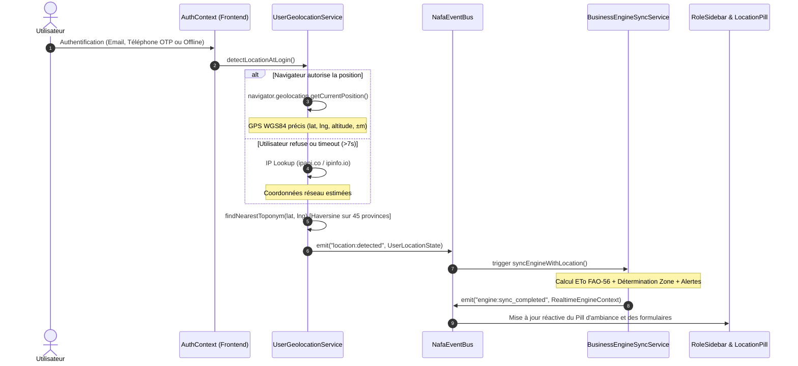
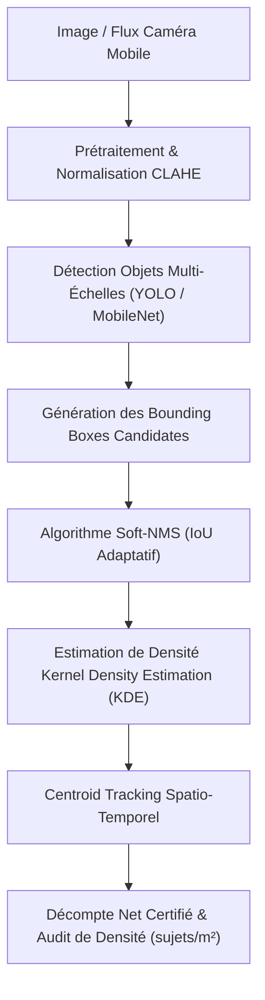

# DOCUMENT TECHNIQUE COMPLET DE RÉFÉRENCE : NAFA-AGRITECH
## Plateforme SaaS d'Ingénierie Agro-Pastorale, Hydraulique & Décisionnelle Sahélienne
**Version du Document :** 2.4.0  
**Statut :** Document d'Ingénierie Officiel  
**Date d'Édition :** Octobre 2026  
**Classification :** Architecture Système, Spécifications Mathématiques & Guide d'Implémentation  

---

## TABLE DES MATIÈRES
1. [Fiche Signalétique & Vision d'Ingénierie](#1-fiche-signalétique--vision-dingénierie)
2. [Architecture Globale du Système (N-Tiers & Dual-Engine)](#2-architecture-globale-du-système-n-tiers--dual-engine)
3. [Architecture Événementielle (Event-Driven) & Géolocalisation Temps Réel](#3-architecture-événementielle-event-driven--géolocalisation-temps-réel)
4. [Moteur d'Ingénierie Agronomique & Calcul Évapotranspiration FAO-56](#4-moteur-dingénierie-agronomique--calcul-évapotranspiration-fao-56)
5. [Moteur d'Ingénierie Hydraulique & Réseaux d'Irrigation](#5-moteur-dingénierie-hydraulique--réseaux-dirrigation)
6. [Moteur d'Ingénierie Zootechnique & Vision par Ordinateur (IMV Smart Counting)](#6-moteur-dingénierie-zootechnique--vision-par-ordinateur-imv-smart-counting)
7. [Moteur Phytosanitaire, Bibliothèque Botanique & RAG Hybride (PlantNet / CABI)](#7-moteur-phytosanitaire-bibliothèque-botanique--rag-hybride-plantnet--cabi)
8. [Studio 3D, Topographie, Géodésie & Export QGIS](#8-studio-3d-topographie-géodésie--export-qgis)
9. [Architecture de Données, Sécurité (CyberShield) & Mode Hors-Ligne](#9-architecture-de-données-sécurité-cybershield--mode-hors-ligne)
10. [Référentiel des Endpoints API & Spécifications Techniques](#10-référentiel-des-endpoints-api--spécifications-techniques)
11. [Déploiement, DevOps & Maintenance Industrielle](#11-déploiement-devops--maintenance-industrielle)

---

## 1. Fiche Signalétique & Vision d'Ingénierie

### 1.1 Présentation de la Solution
**NAFA-AGRITECH** (également désignée sous le nom opérationnel **KoobNaaba Agro Hub**) est une infrastructure technologique et progicielle complète conçue pour adresser les défis critiques de la productivité agricole, de la gestion de l'eau et de la sécurité alimentaire en zone sahélienne et sub-sahélienne, avec un ancrage prioritaire au Burkina Faso et dans l'espace UEMOA/CEDEAO.

La plateforme intègre dans une suite unifiée :
- Le dimensionnement hydraulique de précision (réseaux d'irrigation goutte-à-goutte, aspersion, canaux et pompage solaire).
- Le calcul agronomique en temps réel des besoins hydriques selon la norme universelle **FAO-56 Penman-Monteith**.
- Le diagnostic phytosanitaire par vision par ordinateur et RAG hybride, interconnecté aux référentiels mondiaux (**PlantNet**) et réglementaires régionaux (**Comité Sahélien des Pesticides - CSP / CILSS** et **CABI BioProtection**).
- Le suivi zootechnique et avicole assisté par intelligence artificielle (correction du surcomptage par vision multi-échelle, audit de densité et indice bioclimatique de stress thermique THI).
- La modélisation topographique 2D/3D avec projection géodésique WGS84 / UTM Zone 30N et interopérabilité SIG native avec **QGIS**.
- Un moteur de commerce électronique et logistique territorial adapté aux réalités locales (agrégation de paiement mobile money : Orange Money, Moov Money, Coris Money, Sank Money ; facturation normalisée OHADA).

### 1.2 Normes & Standards Industriels de Conformité
| Domaine | Norme / Référentiel Intégré | Implémentation dans NAFA |
| :--- | :--- | :--- |
| **Besoins en Eau** | FAO Irrigation and Drainage Paper No. 56 | Calcul $ET_0$ Penman-Monteith & coefficients culturaux $K_c$ multi-stades |
| **Hydraulique** | Darcy-Weisbach, Colebrook-White, Hazen-Williams | Équations de friction, solveur Hardy Cross / Newton-Raphson pour mailles |
| **Pompes & Cavitation** | Norme ISO 9906 / Hydraulics Institute | Courbes caractéristiques HMT, calcul NPSH disponible vs NPSH requis |
| **Homologation Phyto** | Décisions et Directives CSP-CILSS | Filtrage strict des substances autorisées, doses et délais avant récolte (DAR) |
| **SIG & Géodésie** | EPSG:4326 (WGS84) & EPSG:32630 (UTM Zone 30N) | Rapprochement toponymique Haversine & export GeoJSON OGC |
| **Comptabilité** | Droit Comptable OHADA Révisé (SYSCOHADA) | Numérotation séquentielle certifiée, ventilation TVA 18%, acomptes |
| **Confidentialité** | Loi n°001-2021/AN (Burkina Faso) / RGPD | Chiffrement AES-GCM, pseudonymisation, gestion du consentement |

---

## 2. Architecture Globale du Système (N-Tiers & Dual-Engine)

NAFA-AGRITECH adopte un paradigme **Dual-Engine** couplant la réactivité d'un frontend Single-Page Application (SPA) Web ultra-optimisé avec la puissance de calcul tensoriel et scientifique d'un moteur Python asynchrone.

```
┌────────────────────────────────────────────────────────────────────────┐
│                        FRONTEND CLIENT (PWA)                           │
│  React 18 + TypeScript + Vite + Tailwind CSS + Lucide + Shadcn UI      │
│                                                                        │
│  ┌──────────────────────┐  ┌────────────────────┐  ┌─────────────────┐ │
│  │  NafaEventBus        │  │  IndexedDB (Dexie) │  │  Precision CAD  │ │
│  │  Événements Réactifs │  │  Offline-First DB  │  │  Canvas 2D / 3D │ │
│  └──────────┬───────────┘  └─────────┬──────────┘  └─────────────────┘ │
└─────────────┼────────────────────────┼─────────────────────────────────┘
              │                        │
       HTTP / REST (JSON)              │ Sync PWA / REST
              ▼                        ▼
┌───────────────────────────────┐ ┌──────────────────────────────────────┐
│  MOTEUR PYTHON DE CALCUL      │ │  BACKEND DE PERSISTANCE              │
│  FastAPI + Uvicorn (Port 8000)│ │  Supabase / PostgreSQL               │
│                               │ │                                      │
│  • FAO-56 Penman-Monteith     │ │  • Auth & Phone Deterministic UUID   │
│  • Hydraulique Hardy Cross    │ │  • Row Level Security (RLS)          │
│  • Computer Vision (IMV/YOLO) │ │  • Stockage Fichiers (S3 Storage)    │
│  • Export QGIS / GeoJSON      │ │  • Tables Métier & Audit Logs        │
│  • RAG Phytosanitaire Hybride │ │  • Agrégateur Paiement Mobile Money  │
└───────────────────────────────┘ └──────────────────────────────────────┘
```

### 2.1 Piles Technologiques
- **Frontend SPA / PWA** :
  - **Framework** : React 18 avec TypeScript en mode strict.
  - **Bundler & Tooling** : Vite 5, Tailwind CSS v3, PostCSS, Autoprefixer.
  - **Composants d'Interface** : Radix UI primitives, Lucide Icons, Sonner (Toasts contextuels).
  - **Visualisation & Rendu Graphique** : HTML5 Canvas haute performance, Leaflet / MapLibre pour la cartographie spatiale.
  - **Stockage Hors-Ligne** : IndexedDB encapsulé via Dexie.js et `localStorage` sécurisé.
- **Moteur Scientifique d'Ingénierie (Python)** :
  - **Runtime & Framework** : Python 3.11+, FastAPI, Starlette, Uvicorn (ASGI).
  - **Typage & Validation** : Pydantic v2 avec schémas stricts et validation à l'entrée.
  - **Calcul Scientifique** : NumPy, SciPy (optimisation non-linéaire, solveurs de matrices creuses).
  - **Traitement d'Image & Vision** : OpenCV (`cv2`), Pillow, algorithmes de filtrage adaptatif et NMS (Non-Maximum Suppression).
- **Couche Données & Services Décentralisés** :
  - **Base de Données Relationnelle** : PostgreSQL managé par Supabase avec politiques RLS (Row Level Security).
  - **Authentification Hybride** : Supabase Auth (Email/Password), OTP SMS sécurisé par UUID déterministe via hachage polynomial 64-bit, et Mode Invité (Guest Session).

---

## 3. Architecture Événementielle (Event-Driven) & Géolocalisation Temps Réel

Le système intègre un pipeline événementiel découplé permettant l'actualisation instantanée du modèle agronomique et financier dès la connexion d'un utilisateur.



### 3.1 Le Bus d'Événements Central (`src/services/eventBus.ts`)
Le composant `NafaEventBus` assure la communication asynchrone par publication/abonnement (Publish/Subscribe) sans couplage direct entre les composants UI et les services de calcul :
- **Typage exhaustif des événements** :
  - `auth:login` / `auth:logout` : Cycles d'authentification utilisateur.
  - `location:detected` / `location:error` : Émission des coordonnées capturées ou des incidents de permission.
  - `engine:sync_started` / `engine:sync_completed` / `engine:sync_error` : Cycles de mise à jour du moteur de calcul.
  - `agro:alert_emitted` : Déclenchement d'une alerte sanitaire ou climatique majeure.
- **Rétention d'État (`getLastPayload`)** : Permet à un composant React fraîchement monté de récupérer immédiatement le dernier état émis sans attendre un nouvel événement.

### 3.2 Détection Hybride & Tolérance aux Pannes (`src/services/userGeolocationService.ts`)
La capture de la position s'effectue selon une stratégie de dégradation gracieuse en 3 niveaux :
1. **Mode A : Navigateur HTML5 (Précis)**
   - Utilise l'API `navigator.geolocation.getCurrentPosition`.
   - Paramétré avec `enableHighAccuracy: true` et un timeout strict de 7000 ms.
   - Restitue latitude, longitude, altitude et rayon d'incertitude en mètres.
2. **Mode B : Rétrogradation IP (Réseau)**
   - Déclenché immédiatement en cas de `PERMISSION_DENIED`, `POSITION_UNAVAILABLE` ou expiration du délai.
   - Interroge les API `ipapi.co` ou `ipinfo.io` pour déduire la ville, la région et le pays sans bloquer l'accès utilisateur.
3. **Mode C : Référentiel Toponymique National Burkinabè (`src/lib/burkinaToponyms.ts`)**
   - Rapprochement immédiat des coordonnées brutes par calcul de distance orthodromique de Haversine :
     $$d = 2 R \arcsin \left( \sqrt{\sin^2\left(\frac{\Delta \varphi}{2}\right) + \cos(\varphi_1)\cos(\varphi_2)\sin^2\left(\frac{\Delta \lambda}{2}\right)} \right)$$
   - Associe instantanément la position au pôle agro-pastoral le plus proche (ex. *Bagré Pôle*, *Vallée du Sourou*, *Plaine de Bama*, *Kamboinsé*).

---

## 4. Moteur d'Ingénierie Agronomique & Calcul Évapotranspiration FAO-56

L'estimation des besoins hydriques s'appuie sur la mise en œuvre rigoureuse de la méthode universelle **FAO-56 Penman-Monteith**, implémentée à la fois dans le cœur TypeScript côté client (`src/engineering/agronomy/fao56PenmanMonteith.ts`) et dans le moteur Python côté serveur (`engine_python/nafa/field_suite.py`).

### 4.1 Formulation Mathématique Universelle FAO-56
L'évapotranspiration de référence journalière ($ET_0$, exprimée en $\text{mm}\cdot\text{jour}^{-1}$) pour une surface herbeuse de référence de 0,12 m de hauteur, avec une résistance de couvert de $70\text{ s}\cdot\text{m}^{-1}$ et un albédo de 0,23 est régie par l'équation :

$$ET_0 = \frac{0{,}408 \Delta (R_n - G) + \gamma \frac{900}{T + 273} u_2 (e_s - e_a)}{\Delta + \gamma (1 + 0{,}34 u_2)}$$

Où :
- $R_n$ : Rayonnement net à la surface de la culture $[\text{MJ}\cdot\text{m}^{-2}\cdot\text{jour}^{-1}]$.
- $G$ : Densité du flux de chaleur du sol $[\text{MJ}\cdot\text{m}^{-2}\cdot\text{jour}^{-1}]$ (pris égal à $0$ pour une échelle journalière).
- $T$ : Température moyenne quotidienne de l'air à 2 m de hauteur $[^\circ\text{C}]$.
- $u_2$ : Vitesse moyenne quotidienne du vent à 2 m de hauteur $[\text{m}\cdot\text{s}^{-1}]$.
- $e_s$ : Pression de vapeur saturante moyenne $[\text{kPa}]$, calculée par :
  $$e^0(T) = 0{,}6108 \exp\left(\frac{17{,}27 T}{T + 237{,}3}\right)$$
  $$e_s = \frac{e^0(T_{\max}) + e^0(T_{\min})}{2}$$
- $e_a$ : Pression de vapeur réelle $[\text{kPa}]$, déduite de l'humidité relative $HR$ :
  $$e_a = e_s \times \frac{HR_{\text{mean}}}{100}$$
- $\Delta$ : Pente de la courbe de pression de vapeur saturante $[\text{kPa}\cdot{^\circ\text{C}}^{-1}]$ :
  $$\Delta = \frac{4098 \left[0{,}6108 \exp\left(\frac{17{,}27 T}{T + 237{,}3}\right)\right]}{(T + 237{,}3)^2}$$
- $\gamma$ : Constante psychrométrique $[\text{kPa}\cdot{^\circ\text{C}}^{-1}]$ dépendante de la pression atmosphérique $P$ (ajustée à l'altitude $z$) :
  $$P = 101{,}3 \left(\frac{293 - 0{,}0065 z}{293}\right)^{5{,}26}$$
  $$\gamma = 0{,}665 \times 10^{-3} P$$

### 4.2 Besoins en Eau Culturaux & Pilotage de l'Irrigation
Les besoins nets d'une culture donnée ($ET_c$) sont calculés à partir des coefficients culturaux $K_c$ définis pour chaque phase phénologique (initiale, développement, mi-saison, fin de cycle) stockés dans la base botanique :
$$ET_c = K_c \times ET_0$$

Le besoin brut d'irrigation ($IN_{\text{brut}}$, en $\text{mm}$ ou $\text{m}^3\cdot\text{ha}^{-1}$) intègre l'efficience d'application du système d'irrigation $\eta_{\text{sys}}$ ($0{,}90$ pour le goutte-à-goutte, $0{,}75$ pour l'aspersion, $0{,}55$ pour le gravitaire) et la fraction de lessivage de salinité $LF$ :
$$IN_{\text{brut}} = \frac{ET_c - P_{\text{eff}}}{\eta_{\text{sys}} \times (1 - LF)}$$

---

## 5. Moteur d'Ingénierie Hydraulique & Réseaux d'Irrigation

Le module hydraulique de NAFA (`src/engineering/hydraulics/` et `field_suite.py`) exécute le dimensionnement des canalisations sous pression, le calcul des pertes de charge linéaires et singulières, la régulation des pressions et la modélisation des stations de pompage solaire.

### 5.1 Équations de Friction & Pertes de Charge

#### 1. Formulation Universelle de Darcy-Weisbach
Pour toute conduite de diamètre intérieur $D$ $[\text{m}]$, de longueur $L$ $[\text{m}]$, transportant un fluide à vitesse $V$ $[\text{m}\cdot\text{s}^{-1}]$ :
$$h_f = f \cdot \frac{L}{D} \cdot \frac{V^2}{2g}$$

Le coefficient de frottement adimensionnel $f$ est calculé selon le régime d'écoulement défini par le nombre de Reynolds $Re = \frac{V D}{\nu}$ :
- **Régime Laminaire ($Re \le 2000$)** :
  $$f = \frac{64}{Re}$$
- **Régime Turbulent Lisse / Transitoire / Rugueux ($Re > 4000$)** :
  Résolution de l'équation implicite de **Colebrook-White** par approximation explicite ultra-précise de Swamee-Jain :
  $$f = \frac{0{,}25}{\left[\log_{10}\left(\frac{\varepsilon / D}{3{,}7} + \frac{5{,}74}{Re^{0{,}9}}\right)\right]^2}$$
  *(où $\varepsilon$ représente la rugosité absolue du matériau : $0{,}0015\text{ mm}$ pour le PEHD, $0{,}007\text{ mm}$ pour le PVC).*

#### 2. Formulation Empirique de Hazen-Williams (pour vérification rapide)
$$h_f = 10{,}67 \cdot L \cdot Q^{1{,}852} \cdot C^{-1{,}852} \cdot D^{-4{,}87}$$
*(avec coefficient $C = 150$ pour tubes plastiques neufs).*

### 5.2 Pertes de Charge Singulières & Accessoires
Calculées par la méthode des coefficients de résistance cinétique $K$ :
$$h_s = \sum K_i \cdot \frac{V^2}{2g}$$
Prise en compte standardisée des coudes $90^\circ$ ($K=0{,}9$), vannes à opercule ouvertes ($K=0{,}2$), réducteurs ($K=0{,}5$), et filtres à disques encrassés à $30\%$ ($\Delta H_{\text{filtre}} \ge 0{,}3\text{ bar}$).

### 5.3 Solveur de Réseaux Maillés (Algorithme de Hardy Cross / Newton-Raphson)
Pour les réseaux tertiaires bouclés et les rampes d'irrigation à sorties multiples :
1. Application de la loi de conservation des débits aux nœuds :
   $$\sum Q_{\text{entrants}} - \sum Q_{\text{sortants}} = 0$$
2. Application de la loi de conservation des charges sur chaque boucle $k$ :
   $$\sum_{i \in \text{boucle } k} h_{f,i} = 0$$
3. Calcul itératif du débit correctif de boucle $\Delta Q$ :
   $$\Delta Q = -\frac{\sum r Q |Q|^{n-1}}{\sum n r |Q|^{n-1}}$$

### 5.4 Dimensionnement des Stations de Pompage Solaire Photovoltaïque
Le module calcule la Hauteur Manométrique Totale ($HMT$) requise :
$$HMT = H_{\text{géo}} + \sum h_f + \sum h_s + P_{\text{service}}$$

Où :
- $H_{\text{géo}}$ : Dénivelé géométrique (niveau dynamique du forage + altitude du réservoir de stockage).
- $P_{\text{service}}$ : Pression minimale requise en tête de rampe (ex. $1{,}0\text{ bar} = 10{,}2\text{ mCE}$ pour goutteurs autorégulants).

La puissance hydraulique nette requise $P_{\text{hyd}}$ $[\text{W}]$ pour un débit de pointe $Q$ $[\text{m}^3\cdot\text{h}^{-1}]$ :
$$P_{\text{hyd}} = \frac{\rho \cdot g \cdot Q \cdot HMT}{3600}$$

La puissance crête du générateur photovoltaïque ($W_c$) est calculée en intégrant l'irradiation solaire journalière disponible dans la région ($H_{\text{sol}}$, typiquement $5{,}5$ à $6{,}2\text{ kWh}\cdot\text{m}^{-2}\cdot\text{jour}^{-1}$ au Burkina Faso) et le facteur de performance global du système $PR$ ($0{,}65$ à $0{,}75$) :
$$P_{\text{solaire\_crête}} (W_c) = \frac{E_{\text{hyd\_jour}}}{H_{\text{sol}} \times PR}$$

---

## 6. Moteur d'Ingénierie Zootechnique & Vision par Ordinateur (IMV Smart Counting)

Le module zootechnique combine la science biométéorologique et des algorithmes d'analyse spatiale pour la conduite rationnelle des élevages bovins, ovins/caprins et avicoles sahéliens.

### 6.1 Indice Bioclimatique THI (Temperature-Humidity Index)
Le stress thermique est l'une des causes principales de mortalité avicole et de chute de lactation chez les bovins en zone sahélienne chaude. NAFA calcule en continu l'indice THI (Norme NRC / Thom) :

$$THI = 0{,}8 \times T + \left(\frac{HR}{100}\right) \times (T - 14{,}4) + 46{,}4$$

| Plage THI | Catégorie de Risque | Impact Zootechnique | Actions Recommandées par NAFA |
| :--- | :--- | :--- | :--- |
| **$THI < 72$** | Zone de Confort | Métabolisme normal | Conduite standard |
| **$72 \le THI < 78$** | Stress Léger à Modéré | Baisse d'ingestion ($-10\%$) | Renouvellement de l'eau, ventilation passive |
| **$78 \le THI < 84$** | Stress Sévère | Chute de ponte/croissance, halètement | Brumisation d'urgence, Vitamine C, ombrage |
| **$THI \ge 84$** | Danger Mortel Immédiat | Mortalité aiguë par hyperthermie | Arrosage des toitures, arrêt alimentation aux heures chaudes |

### 6.2 Formulation de Rations à Moindre Coût (Solveur Simplex)
Le sous-module `leastCostRation.ts` résout un programme linéaire d'optimisation pour composer une ration nutritionnellement équilibrée au coût minimum, en exploitant les matières premières locales burkinabè (tourteau de coton, son de maïs, son de blé, drèche de brasserie, farine de poisson, coquilles d'huîtres fossiles de Houndé) :

$$\min \sum_{j=1}^{n} c_j x_j \quad \text{sous les contraintes :} \quad \sum_{j=1}^{n} a_{ij} x_j \ge b_i \quad \text{et} \quad x_j \ge 0$$

Où $c_j$ est le prix au kilogramme de l'intrant $j$, $a_{ij}$ sa teneur en nutriment $i$ (énergie métabolisable, protéines brutes, lysine, méthionine, calcium, phosphore disponible), et $b_i$ le besoin nutritionnel minimal de la phase d'élevage.

### 6.3 Algorithme IMV Smart Counting & Résolution du Surcomptage Avicole
Pour le comptage automatique des volailles et petits ruminants à partir de flux vidéo ou d'images zénithales, un problème fréquent réside dans le surcomptage dû aux regroupements denses, aux superpositions corporelles et aux mouvements rapides.



Le pipeline de correction déploie :
1. **Suppression Non-Maximale Douce (Soft-NMS)** : Décroissance gaussienne du score de confiance pour les boîtes chevauchantes au lieu d'une élimination abrupte :
   $$s_i = s_i \exp\left(-\frac{\text{IoU}(M, b_i)^2}{\sigma}\right)$$
2. **Estimation de Carte de Densité par Noyaux Gaussiens (KDE)** :
   Dans les grappes compactes de volailles où les contours individuels disparaissent, l'algorithme substitue la détection d'objets discrets par l'intégration spatiale d'une fonction de densité continue :
   $$D(x, y) = \sum_{k=1}^{N} \frac{1}{2\pi \sigma^2} \exp\left(-\frac{(x - x_k)^2 + (y - y_k)^2}{2\sigma^2}\right)$$
   Le nombre total d'individus correspond à l'intégrale $\iint D(x, y) \, dx dy$.
3. **Audit de Densité Spatiale** : Détection automatique des dépassements du seuil critique de bien-être animal (ex. $> 10\text{ poulets/m}^2$ en claustration sahélienne).

---

## 7. Moteur Phytosanitaire, Bibliothèque Botanique & RAG Hybride (PlantNet / CABI)

### 7.1 Référentiel Botanique Sahélien de 235 Espèces (`cropLibrarySheets235.ts`)
NAFA embarque une bibliothèque de fiches techniques standardisées couvrant l'ensemble du patrimoine cultural d'Afrique de l'Ouest :
- **Céréales majeures** : Mil pénicillaire, sorgho grain, maïs, riz pluvial et irrigué, fonio.
- **Légumineuses & Protéagineux** : Niébé, arachide, voandzou, soja, sésame.
- **Cultures maraîchères & horticoles** : Tomate, oignon de Garango, piment, gombo, chou, aubergine locale, pastèque.
- **Cultures de rente & vergers** : Coton conventionnel et biologique, anacardier (noix de cajou), manguier (variétés Amélie, Kent, Brooks), agrumes, papaye.

Chaque fiche détaille : les cycles de développement, les stades thermiques ($GDD$, degrés-jours de développement), les coefficients $K_c$ phénologiques, les profondeurs d'enracinement effectives ($Z_r$), et les seuils de déplétion hydrique facilement utilisable ($p$).

### 7.2 Diagnostic Multimodal & Pipeline RAG Hybride
Le diagnostic de maladies foliaires et bio-agresseurs est réalisé par une architecture à deux étages :
1. **Étage Visuel** : Intégration de l'API mondiale **PlantNet** complétée par un modèle local de vision convolutive spécialisé sur les pathologies sahéliennes (flétrissement bactérien *Ralstonia*, virose TYLCV, chenille légionnaire *Spodoptera frugiperda*, cercosporiose).
2. **Étage RAG Botanique & Phytosanitaire** :
   - Indexation vectorielle de la base de connaissances du **CABI BioProtection Portal**.
   - Consultation directe de la liste officielle des produits homologués par le **Comité Sahélien des Pesticides (CSP-CILSS)**.
   - Recommandation prioritaire de solutions de biocontrôle (extraits hydroalcooliques de graines de Neem *Azadirachta indica*, biofongicides à base de *Trichoderma harzianum*, bio-insecticides *Bacillus thuringiensis*).
   - Génération automatique des consignes de sécurité : Délais d'Attente Avant Récolte (DAR en jours), Équipements de Protection Individuelle (EPI), et précautions pour les insectes pollinisateurs.

---

## 8. Studio 3D, Topographie, Géodésie & Export QGIS

### 8.1 Géodésie & Conversion Cartographique
Le module de géodésie (`src/engineering/geodesy/`) implémente la transformation bidirectionnelle rigoureuse entre :
- Les coordonnées sphériques universelles **WGS84 (EPSG:4326)** issues des récepteurs GPS de terrain.
- Les coordonnées cartographiques projetées planes métriques **UTM Zone 30N (EPSG:32630)** appliquées sur l'ellipsoïde GRS80/WGS84 :
  $$a = 6378137{,}0\text{ m}, \quad f = \frac{1}{298{,}257223563}$$

Cette projection métrique permet le calcul précis sans déformation des périmètres parcellaires, des surfaces au millimètre carré près, et des longueurs réelles de canalisations hydrauliques.

### 8.2 Modélisation Numérique de Terrain (MNT) & Maillage TIN
- **Triangulation de Delaunay 2D/3D** : Génération automatique d'un Réseau Irrégulier de Triangles (TIN) à partir du levé topographique de points cotés $(X, Y, Z)$.
- **Génération des Courbes de Niveau (Isolignes)** : Calcul des courbes maîtresses et secondaires pour visualiser les lignes de plus grande pente et prévenir l'érosion hydrique.
- **Calcul des Cubatures de Terrassement** : Algorithme des prismes triangulaires pour l'équilibrage déblai/remblai lors de la confection de diguettes anti-érosives ou de bassins de rétention des eaux de ruissellement (boulis sahéliens).

### 8.3 Moteur d'Exportation QGIS Standardisé (`src/services/qgisExportEngine.ts`)
Génère à la demande des packages d'échange compatibles avec les logiciels SIG professionnels (QGIS, ArcGIS) :
- **GeoJSON RFC 7946** conforme, avec géométries `Polygon` (parcelles, zones de rotation), `LineString` (canalisations primaires, secondaires et tertiaires), et `Point` (vannes, têtes de réseau, bornes de forage, asperseurs).
- **Table d'Attributs Enrichie** : Chaque tronçon hydraulique embarque dans son GeoJSON le diamètre nominal ($DN$), le matériau, le débit de calcul ($m^3/h$), la perte de charge estimée ($\text{mCE}$) et la classe de pression ($PN$).

---

## 9. Architecture de Données, Sécurité (CyberShield) & Mode Hors-Ligne

### 9.1 Matrice de Sécurité & Rôles Applicatifs (RBAC)
NAFA-AGRITECH applique un cloisonnement étanche des fonctionnalités selon 6 profils certifiés :

| Rôle Métier | Périmètre d'Accès & Privilèges | Droits Spécifiques |
| :--- | :--- | :--- |
| **Producteur** | Gestion des parcelles, suivi irrigation, bourses et commandes | Accès calculs ETo simplifiés, commande intrants |
| **Agronome Expert** | Diagnostic phyto approfondi, validation des ordonnances culturales | Signature numérique des diagnostics, export QGIS |
| **Vétérinaire** | Suivi sanitaire des cheptels, déclaration prophylaxie, alertes | Validation des rations alimentaires, carnet de vaccination |
| **Fournisseur** | Catalogue d'intrants et équipements, gestion des stocks | Facturation OHADA, suivi des bordereaux de livraison |
| **Acheteur / Commerçant** | Bourse agricole, mercuriale de prix, ordres de fret | Achat groupé, tracking logistique des cargaisons |
| **Super Administrateur** | Audit sécurité, gestion plateforme, paramétrage territorial | Accès logs CyberShield, administration des comptes |

### 9.2 Module CyberShield Autonome (`src/lib/cyberShield.ts`)
- **Détection des Attaques par Rejeu** : Horodatage cryptographique ($HMAC\text{-}SHA256$) et nonce unique sur toutes les requêtes de transaction financière.
- **Rate Limiting Distribué** : Limitation stricte des requêtes sur les services d'envoi d'OTP SMS et de réinitialisation de mot de passe (maximum 3 tentatives par tranche de 15 minutes).
- **Contrôle d'Intégrité des Données Hors-Ligne** : Signatures checksum sur les enregistrements locaux synchronisés pour prévenir toute altération malveillante côté client.

### 9.3 Stratégie Offline-First & Synchronisation Asynchrone
En zone rurale sahélienne dépourvue de couverture 4G/3G stable, l'application fonctionne à 100% de ses capacités analytiques en local :
- **Moteur de Stockage Local** : IndexedDB piloté par Dexie.js stocke l'intégralité des 235 fiches culturales, les polygones des parcelles et les relevés de terrain.
- **File d'Attente de Synchronisation (`SyncQueue`)** : Toutes les créations/modifications hors-ligne sont enregistrées avec UUID v4 généré localement et statut `pending_sync`.
- **Résolution des Conflits** : Application de la règle du dernier écrivain (*Last-Write-Wins*) combinée à un journal d'audit chronologique infalsifiable. Dès la reconnexion au réseau, un worker d'arrière-plan vide la file par lots (batch upload).

---

## 10. Référentiel des Endpoints API & Spécifications Techniques

Le backend FastAPI (`engine_python/nafa/api.py`) expose une interface REST asynchrone documentée sous OpenAPI v3 (Swagger).

### 10.1 Spécifications des Endpoints Majeurs

#### `POST /api/field-suite/hydraulics`
Calcule les pertes de charge et la conformité hydraulique d'une canalisation ou d'une rampe.
- **Payload d'Entrée :**
```json
{
  "length_m": 120.0,
  "flow_rate_m3h": 4.5,
  "diameter_inner_mm": 40.0,
  "roughness_mm": 0.0015,
  "pipe_material": "PEHD",
  "temperature_c": 28.0,
  "static_head_m": 15.0
}
```
- **Réponse :**
```json
{
  "velocity_ms": 1.0,
  "reynolds_number": 48250,
  "flow_regime": "turbulent",
  "friction_factor": 0.0215,
  "linear_head_loss_m": 2.85,
  "total_head_loss_m": 3.14,
  "hmt_required_m": 18.14,
  "recommended_nominal_pressure_bar": 6.0,
  "is_velocity_compliant": true
}
```

---

#### `POST /api/modeling/parcel-2d`
Génère la topologie parcellaire métrique, la surface exacte, le périmètre et la projection QGIS GeoJSON.
- **Payload d'Entrée :**
```json
{
  "points_wgs84": [
    {"lat": 12.3714, "lng": -1.5197, "elevation_m": 305.0},
    {"lat": 12.3730, "lng": -1.5197, "elevation_m": 306.2},
    {"lat": 12.3730, "lng": -1.5175, "elevation_m": 304.8},
    {"lat": 12.3714, "lng": -1.5175, "elevation_m": 303.9}
  ],
  "target_crs": "EPSG:32630"
}
```
- **Réponse :**
```json
{
  "area_hectares": 4.12,
  "perimeter_m": 820.5,
  "centroid_wgs84": {"lat": 12.3722, "lng": -1.5186},
  "utm_zone": "30N",
  "slope_average_pct": 1.45,
  "geojson_rfc7946": {
    "type": "Feature",
    "geometry": {
      "type": "Polygon",
      "coordinates": [[[-1.5197, 12.3714], [-1.5197, 12.3730], [-1.5175, 12.3730], [-1.5175, 12.3714], [-1.5197, 12.3714]]]
    },
    "properties": {
      "area_ha": 4.12,
      "province": "Kadiogo",
      "soil_profile": "laterite"
    }
  }
}
```

---

#### `POST /api/livestock/audit-density`
Exécute l'audit de densité et la détection d'individus avec correction de surcomptage.
- **Payload d'Entrée :**
```json
{
  "species": "poultry_broiler",
  "shed_surface_m2": 150.0,
  "detected_boxes": [
    {"x1": 10, "y1": 15, "x2": 45, "y2": 50, "score": 0.92},
    {"x1": 12, "y1": 17, "x2": 48, "y2": 52, "score": 0.78}
  ],
  "temperature_c": 35.0,
  "humidity_pct": 45.0
}
```
- **Réponse :**
```json
{
  "raw_count": 2,
  "corrected_count_after_nms": 1,
  "density_per_m2": 0.007,
  "thi_index": 82.4,
  "thi_category": "severe_stress",
  "welfare_alert": true,
  "recommendations": [
    "Activer brumisation",
    "Distribuer solution d'électrolytes et vitamine C",
    "Réduire la densité d'élevage"
  ]
}
```

---

#### `POST /api/copilot/chat`
Copilote agronomique universel multilingue (Français, Moore, Dioula).
- **Payload d'Entrée :**
```json
{
  "message": "Quelle quantité d'eau apporter à mes tomates à Kamboinsé au stade floraison aujourd'hui ?",
  "user_context": {
    "role": "producer",
    "location": {"latitude": 12.45, "longitude": -1.55, "city": "Kamboinsé"}
  }
}
```
- **Réponse :**
```json
{
  "reply": "À Kamboinsé aujourd'hui, l'évapotranspiration de référence ETo calculée est de 6.4 mm/jour. Pour la tomate au stade floraison (Kc = 1.15), le besoin net d'eau est de 7.36 mm/jour, soit environ 73.6 m³ par hectare et par jour. Avec votre système de goutte-à-goutte (efficience 90%), prévoyez un apport brut de 82 m³/ha/jour, fractionné en deux arrosages (tôt le matin et en fin d'après-midi).",
  "confidence": 0.96,
  "sources": ["FAO-56 Paper", "Fiche Culturale Tomate NAFA #42"]
}
```

---

## 11. Déploiement, DevOps & Maintenance Industrielle

### 11.1 Matrice des Environnements
- **Environnement de Développement Local** :
  - Frontend : Node.js v20+, Vite Dev Server sur le port standard.
  - Backend Moteur : Python 3.11 avec environnement virtuel isolé (`.venv`), serveur ASGI Uvicorn sur `http://127.0.0.1:8000`.
- **Environnement de Production Conteneurisé** :
  - **Docker Multi-Stage Build** : Image alpine ultra-légère pour le bundle frontend statique servi par Nginx avec compression Brotli/Gzip et headers de cache immuables pour les assets hashés.
  - **FastAPI Production Container** : Déploiement avec Gunicorn orchestrant des workers Uvicorn (`UvicornWorker`) dimensionnés selon la formule recommandée :
    $$N_{\text{workers}} = 2 \times N_{\text{CPU\_cores}} + 1$$

### 11.2 Intégration Continue & Assurance Qualité
- **Vérification Statique TypeScript** : Compilation sans émission `tsc -p tsconfig.app.json --noEmit` intégrée en pré-commit (zéro tolérance pour les erreurs de type `any` non contrôlées).
- **Suites de Tests Automatisés** :
  - **Tests Unitaires & Composants** : Vitest avec environnement `happy-dom` (`src/test/*.test.ts`).
  - **Tests Python** : Pytest avec couverture de code (`engine_python/tests/test_*.py`).
  - **Validation Croisée Epanet** : `generate_epanet_reference.py` pour valider les calculs hydrauliques contre le moteur de référence de l'EPA américaine.

---
*Fin du Document Technique Officiel — NAFA AGRITECH (KoobNaaba).*
